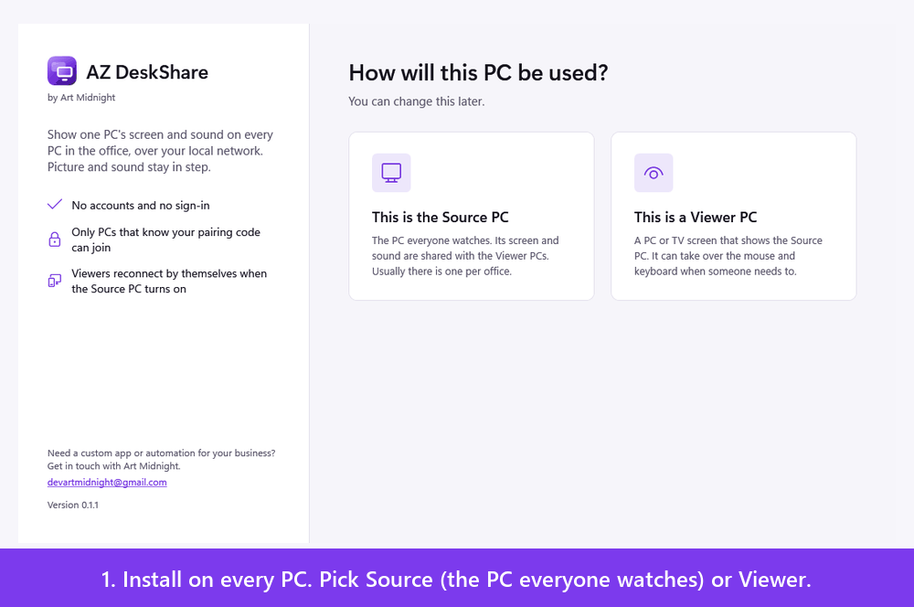
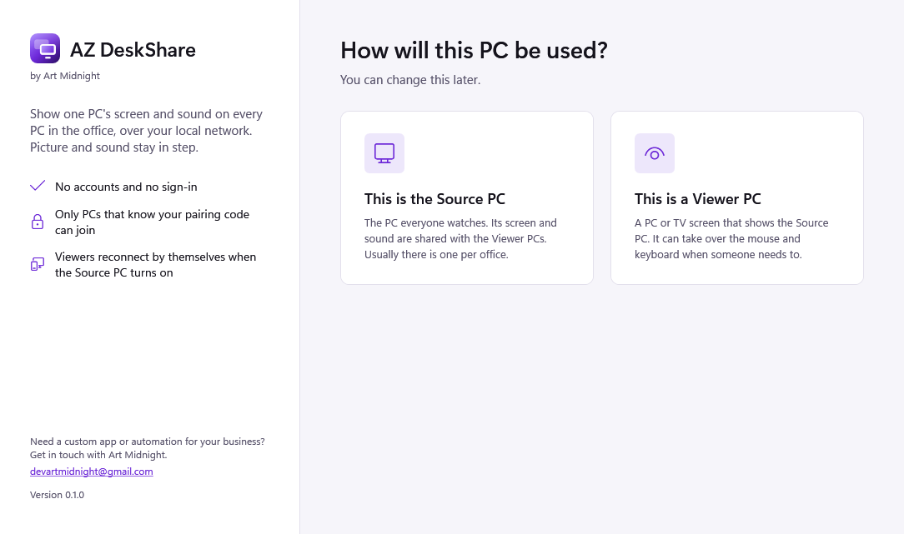
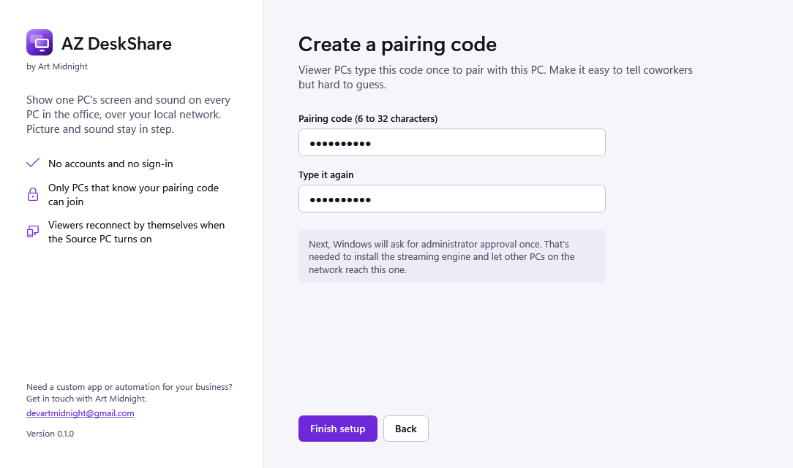
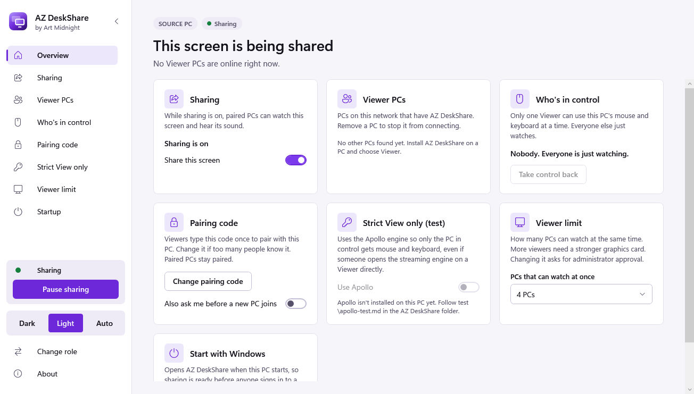
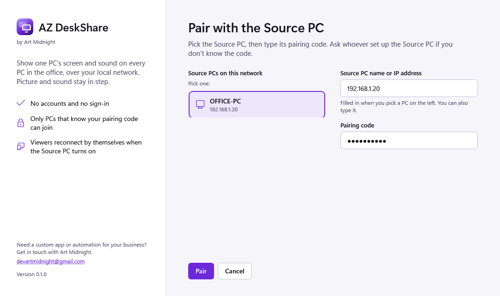
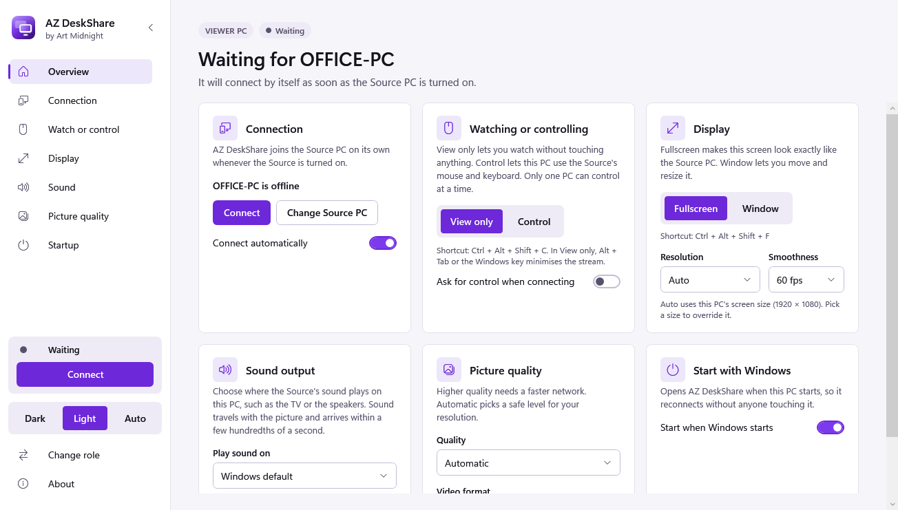
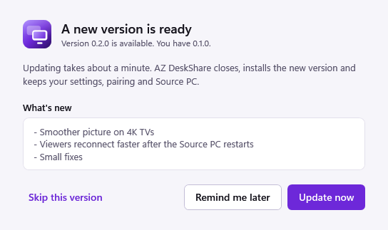
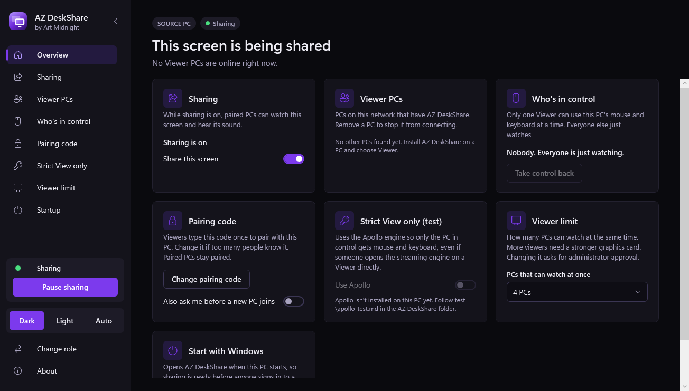

# AZ DeskShare

**by Art Midnight** · devartmidnight@gmail.com

Show one PC's screen and sound on every PC in the office, over your local network. Picture and sound stay in step.

- **One Source PC, many Viewer PCs.** Viewers watch fullscreen, so they look just like the Source, or in a resizable window.
- **View only or Control.** Any Viewer can take over the Source's mouse and keyboard when needed, one PC at a time.
- **Choose where the sound plays** on each Viewer, such as a TV or the PC speakers.
- **Reconnects by itself** whenever the Source PC turns on.
- **No accounts, no sign-in.** Viewers pair once with the Source's pairing code.
- Up to **8K** when the Source PC's graphics card and the network allow it.

## Download
Get **AZDeskShare-Setup-x.y.z.exe** from the [Releases](../../releases) page, and run it on the Source PC and on every Viewer PC.

## Requirements
- Windows 10 (1809 or later) or Windows 11, 64-bit
- All PCs on the same local network. Wired gigabit Ethernet is recommended. Set the network to **Private** in Windows.
- Source PC: a recent graphics card (NVIDIA, AMD or Intel) for hardware video encoding. 4K and 8K need a newer GPU.

## Setup guide

### 1. Install on every PC and pick a role
Run the installer on the Source PC (the one everyone watches) and on every Viewer PC. Accept the licence. When AZ DeskShare opens, pick **This is the Source PC** or **This is a Viewer PC**.

### 2. Source PC: create a pairing code
Make up a code your coworkers can remember (6 to 32 characters) and type it twice. Press **Finish setup** and approve the Windows prompt. This installs the streaming engine and opens the firewall for your local network.

### 3. Source PC: sharing is on
The main window shows **This screen is being shared**. You can pause sharing, see the Viewer PCs, take control back, or change the pairing code here.

### 4. Viewer PC: pair with the Source
Pick the Source PC from the list (or type its name or IP address), type the pairing code, and press **Pair**. You only do this once.

### 5. Viewer PC: watch or take control
The Viewer connects by itself, now and whenever the Source PC turns on. Switch between **View only** and **Control**, pick where the sound plays (for example a TV), and choose fullscreen or a window.

**Shortcuts while watching:** Ctrl+Alt+Shift+C switches View only / Control. Ctrl+Alt+Shift+F switches fullscreen / window.

## Third-party software
AZ DeskShare runs [Sunshine](https://github.com/LizardByte/Sunshine) and [Moonlight](https://github.com/moonlight-stream/moonlight-qt) as its streaming engines. Both are open-source under the GNU GPL v3, and the notices are included with each release.

## Updates
AZ DeskShare checks this page for a new version when it starts and every few hours. When one is out, it asks you: **Update now** downloads and installs it (your settings and pairing are kept), **Remind me later** asks again tomorrow, and **Skip this version** waits for the next one. You can also check any time from **About > Check for updates**.

## Dark mode
Pick **Dark**, **Light** or **Auto** (follows Windows) at the bottom of the side panel.

## Support the developer
AZ DeskShare is free. If it helps your office, you can [buy me a coffee](https://buymeacoffee.com/artmidnight). More ways to tip (GCash, GoTyme Bank, PayPal, USDT) are in the app under **About**.

## Custom apps and automation
Need a custom app or automation for your business? Get in touch with **Art Midnight**: devartmidnight@gmail.com

## License
Free to use for everyone, including at work. It may not be sold, modified or reverse engineered. The full terms are in `LICENSE.txt`, included with each release.
